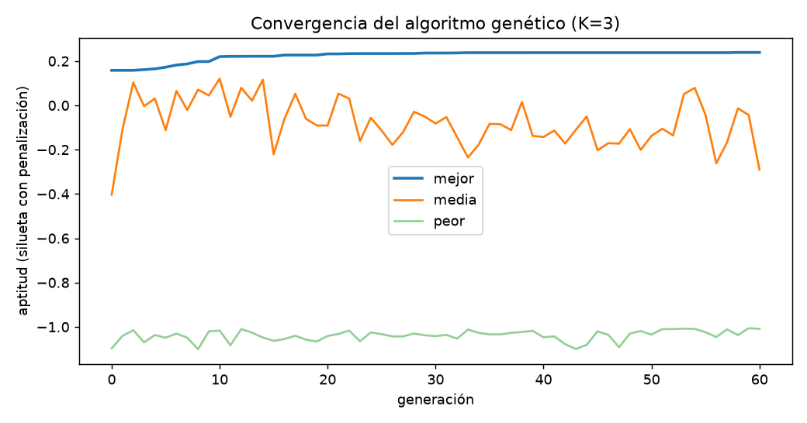
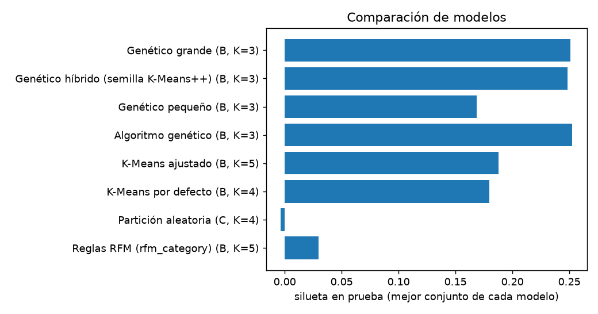
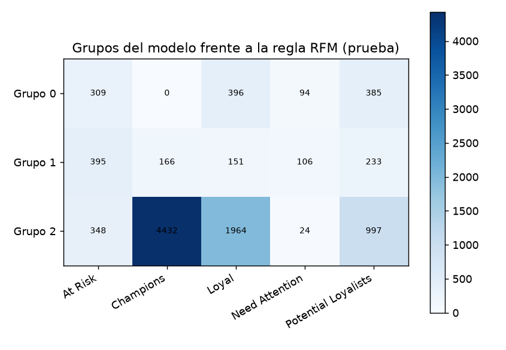

# Entrega 3: Desarrollo, entrenamiento y experimentación del modelo

Fundamentos de Inteligencia Artificial · Proyecto final

| Dato | Valor |
|---|---|
| Fecha de entrega | 11 de noviembre de 2026 (la plantilla indica el 9; ver la sección 6) |
| Nombre del proyecto | E-Commerce AI: Inteligencia Artificial para la gestión y personalización de clientes |
| Equipo / grupo | LITIID73 |
| Docente | Ing. Carlos André Castro Rodríguez |
| Repositorio | https://github.com/AlexRecaman/ecommerce-ai |

**Integrantes y roles**

1. María Tita Fregoso Arechiga — Líder de Datos y Preprocesamiento
2. Jesús Alexander Recaman Lara — Líder de Modelado y Experimentación
3. Henrry Misael Pech Pool — Líder de Pipeline e Integración
4. Gretel Dairen Zavaleta Moctezuma — Gestión del proyecto

## Resumen y diferencias con la Entrega 2

Esta entrega implementa y evalúa el motor de agrupamiento no supervisado comprometido en la Entrega 2 (algoritmo genético frente a K-Means) sobre el dataset de 50,000 clientes. **Las cifras de la Entrega 2 eran proyecciones: no existía código que las produjera.** Lo que sigue son los resultados reales de ejecutar el código del repositorio.

| Concepto | Entrega 2 (proyectado) | Real, conjunto A (8 numéricas de la E2) | Real, mejor modelo |
|---|---|---|---|
| Silueta K=3 | 0.360 | 0.108 (K-Means) | 0.253 (genético, conjunto B) |
| Silueta K=4 | 0.421 | 0.094 (K-Means) | 0.170 (genético, conjunto B) |
| Silueta K=5 | 0.310 | 0.093 (K-Means) | 0.163 (genético, conjunto B) |
| Reglas RFM | 0.140 | 0.029 | 0.030 (conjunto B) |
| Objetivo mínimo (silueta ≥ 0.380) | cumplido (0.421) | **no cumplido** | **no cumplido** (0.253) |
| Grupo más pequeño | 18 % | 15.6 % | 10.5 % |

**Por qué no se alcanzó 0.380.** En este dataset las variables de entrada son prácticamente independientes: la correlación absoluta máxima entre las 8 numéricas de la Entrega 2 es 0.01. Sin relaciones entre variables no hay grupos naturales marcados, y la silueta de cualquier partición es baja. Lo comprobamos de dos maneras: (1) la segmentación por reglas RFM que trae el dataset obtiene apenas 0.030 en ese mismo espacio; (2) con datasets generados con estructura (sección 3, experimento 7) los mismos algoritmos suben a silueta 0.313 a 0.382. Es decir, el modelo funciona; los datos no traen grupos.

Otras diferencias: el algoritmo genético usó 60 generaciones (la Entrega 2 decía 50) y una población de 40; los nombres de los grupos (VIP, en riesgo, etc.) del dashboard actual no salen de este modelo y deberán sustituirse en la Entrega 4 por los de `data/outputs/segments_summary.json`.

## 1. Selección y justificación técnica de los modelos

### A. Estrategia de modelado

- [x] **Estrategia comparativa:** se entrenan dos modelos de familias distintas (algoritmo genético y K-Means) y se comparan con dos líneas base.
- [ ] Estrategia baseline frente a modelo optimizado. (Se hace además, dentro del experimento 6, el ajuste de parámetros del genético.)

### B. Justificación de la elección

| Modelo | Paradigma | Justificación técnica |
|---|---|---|
| **Modelo 1 (candidato): algoritmo genético de agrupamiento** | Computación evolutiva aplicada a aprendizaje no supervisado | Cada individuo es un conjunto de K centroides y la aptitud es directamente la silueta. Esto permite incluir como restricción el tamaño mínimo de grupo (10 % prometido en la Entrega 2) y no depende de la inicialización de un único punto de partida. Costo: no garantiza el óptimo y es más lento (alrededor de un segundo frente a décimas); su estabilidad entre semillas se mide en la sección 3 (ARI 0.76). |
| **Modelo 2 (baseline): K-Means** | Aprendizaje no supervisado, particional | Referencia estándar y rápida (décimas de segundo). Minimiza la inercia, no la silueta, y no tiene restricción de tamaño mínimo; sirve para validar si la complejidad del genético aporta algo. |
| Línea base 1: reglas RFM | Reglas de negocio, sin aprendizaje | La columna `rfm_category` que ya trae el dataset. Silueta 0.030. |
| Línea base 2: partición aleatoria | Sin modelo | K=4, etiquetas al azar. Silueta -0.005 (≈ 0 por definición). |

**Variables de entrada.** Se compararon tres conjuntos. A: las 8 numéricas de la Entrega 2. B: 6 variables conductuales construidas desde columnas base (recencia, compras por mes en logaritmo, valor medio de pedido, tasa de devoluciones en logaritmo, quejas y satisfacción). C: B más las categóricas codificadas (ingreso, educación y frecuencia como ordinales; género, estado civil, empleo, canal, dispositivo, pago y región como 0/1; categorías preferidas ponderadas por orden; redes sociales). Los bloques categóricos se escalan para pesar como una sola variable cada uno. **Ninguna de las 24 columnas derivadas entra a un modelo** (una prueba automática lo verifica); solo se leen para comparar contra las reglas RFM.

## 2. Pipeline de datos y estructura en el repositorio

### A. Ubicación de archivos

| Elemento | Ruta |
|---|---|
| Entrenamiento (script) | `src/models/train.py` |
| Entrenamiento (notebook de Colab) | `notebooks/03_model_training.ipynb` |
| Preprocesamiento | `src/data/preprocess.py` (reglas de las columnas derivadas en `src/data/reglas.py`) |
| Algoritmo genético | `src/models/ga_clustering.py` |
| Inferencia | `src/models/predict.py` |
| Generador de datasets | `src/data/generate.py` |
| Modelos serializados | `models/modelo_candidato.joblib` (y `ga_*`, `kmeans_*` de cada experimento) |
| Escalador y PCA | `models/scaler.joblib`, `models/pca.joblib`, `models/preprocesador.joblib` |
| Reportes | `reports/` (matriz de experimentos, métricas, gráficas, log) |
| Salidas para el dashboard | `data/outputs/customer_assignments.csv`, `segments_summary.json` |
| Pruebas | `tests/` (46 pruebas) |
| Dependencias | `requirements.txt` |

Ninguna ruta es absoluta: todo se resuelve desde la raíz del repositorio.

### B. Comando de reproducibilidad

```
python -m src.models.train --data data/raw/E-commerce_Customer_Segmentation_2026.csv --output models/
```

La corrida usa semilla 42 y dura alrededor de un minuto y medio. Para obtener otros datos de prueba, el generador acepta un número de filas y una semilla:

```
python -m src.data.generate --rows 5000 --seed 7 --estructura 0.6
```

Si se ejecuta sin argumentos pregunta «N. de filas:» y elige una semilla al azar (la imprime y la guarda en el nombre del archivo para poder repetir la corrida).

## 3. Matriz de experimentación y ajuste de hiperparámetros

Todos los modelos se evalúan sobre el mismo conjunto de prueba: 10,000 clientes (20 %), con semilla 42. La configuración ganadora se elige con la silueta de **entrenamiento** (40,000 clientes), entre las que cumplen el grupo mínimo del 10 %; el conjunto de prueba solo se reporta. Tiempos: entrenamiento / inferencia sobre los 10,000 clientes de prueba.

| Variante | Modelo | Hiperparámetros | Métrica principal (test) | Métrica secundaria (test) | Tiempo | Diagnóstico |
|---|---|---|---|---|---|---|
| Exp 1: reglas RFM | Reglas RFM (rfm_category) | 5 categorías del dataset · conjunto B | Silueta: 0.030 | Davies-Bouldin: 5.740 | 0.00 s / 0.0 ms | Estructura débil (casi sin grupos naturales); grupo mínimo 2.2 % |
| Exp 2: aleatoria | Partición aleatoria | K=4, etiquetas al azar · conjunto B | Silueta: -0.005 | Davies-Bouldin: 117.590 | 0.00 s / 0.0 ms | Estructura débil (casi sin grupos naturales) |
| Exp 3: baseline | K-Means por defecto | K=4, n_init=1 · conjunto B | Silueta: 0.180 | Davies-Bouldin: 1.619 | 0.01 s / 0.4 ms | Estable (brecha +0.001); grupo mínimo 3.8 % |
| Exp 4: K-Means K=3 | K-Means ajustado | K=3, n_init=10 · conjunto B | Silueta: 0.164 | Davies-Bouldin: 1.954 | 0.09 s / 0.4 ms | Estable (brecha +0.002) |
| Exp 4: K-Means K=4 | K-Means ajustado | K=4, n_init=10 · conjunto B | Silueta: 0.180 | Davies-Bouldin: 1.619 | 0.09 s / 0.4 ms | Estable (brecha +0.001); grupo mínimo 3.8 % |
| Exp 4: K-Means K=5 | K-Means ajustado | K=5, n_init=10 · conjunto B | Silueta: 0.188 | Davies-Bouldin: 1.492 | 0.09 s / 0.4 ms | Estable (brecha +0.003); grupo mínimo 3.4 % |
| Exp 5: genético K=3 | Algoritmo genético | K=3, población 40, 60 generaciones, mutación 0.2 · conjunto B | Silueta: 0.253 | Davies-Bouldin: 1.985 | 1.08 s / 0.3 ms | Estable (brecha -0.004) |
| Exp 5: genético K=4 | Algoritmo genético | K=4, población 40, 60 generaciones, mutación 0.2 · conjunto B | Silueta: 0.170 | Davies-Bouldin: 1.754 | 1.02 s / 0.4 ms | Estable (brecha +0.004) |
| Exp 5: genético K=5 | Algoritmo genético | K=5, población 40, 60 generaciones, mutación 0.2 · conjunto B | Silueta: 0.163 | Davies-Bouldin: 1.617 | 1.14 s / 0.5 ms | Estable (brecha +0.006) |
| Exp 6: ajuste | Genético pequeño | K=3, población 20, 30 generaciones, mutación 0.2 · conjunto B | Silueta: 0.169 | Davies-Bouldin: 1.995 | 0.37 s / 0.5 ms | Estable (brecha +0.004) |
| Exp 6: ajuste | Genético grande | K=3, población 80, 100 generaciones, mutación 0.3 · conjunto B | Silueta: 0.251 | Davies-Bouldin: 1.583 | 3.88 s / 0.4 ms | Estable (brecha -0.004); grupo mínimo 10.0 % |
| Exp 6: ajuste | Genético híbrido (semilla K-Means++) | K=3, población 40, 60 generaciones, mutación 0.2, semilla K-Means++ · conjunto B | Silueta: 0.248 | Davies-Bouldin: 2.592 | 1.17 s / 0.4 ms | Estable (brecha -0.002) |
| Exp 4: K-Means, conjunto A (mejor K) | K-Means ajustado | K=3, n_init=10 · conjunto A | Silueta: 0.108 | Davies-Bouldin: 2.560 | 0.12 s / 0.4 ms | Estable (brecha -0.000) |
| Exp 5: genético, conjunto A (mejor K) | Algoritmo genético | K=3, población 40, 60 generaciones, mutación 0.2 · conjunto A | Silueta: 0.106 | Davies-Bouldin: 2.577 | 1.11 s / 0.4 ms | Estable (brecha -0.002) |
| Exp 4: K-Means, conjunto C (mejor K) | K-Means ajustado | K=3, n_init=10 · conjunto C | Silueta: 0.167 | Davies-Bouldin: 1.923 | 0.18 s / 0.9 ms | Estable (brecha -0.004); grupo mínimo 4.2 % |
| Exp 5: genético, conjunto C (mejor K) | Algoritmo genético | K=3, población 40, 60 generaciones, mutación 0.2 · conjunto C | Silueta: 0.152 | Davies-Bouldin: 2.301 | 1.21 s / 0.9 ms | Estable (brecha +0.001) |

La matriz completa (30 corridas, con Calinski-Harabasz, tamaño mínimo y silueta de entrenamiento) está en `reports/experimentos.csv`.

### Experimento 7: robustez con datasets generados

Misma configuración (conjunto B, K elegido entre 3, 4 y 5 por silueta de entrenamiento) sobre datasets generados de distinto tamaño. `estructura` es la fracción de clientes que sigue uno de 5 arquetipos (0 = variables independientes, como en el original). El arquetipo real no se le da al modelo; se usa después para calcular el ARI (1 = recupera los grupos reales, 0 = al azar).

| Filas | Estructura | Modelo | K elegido | Silueta (test) | ARI vs arquetipos | ARI con K=5 |
|---|---|---|---|---|---|---|
| 1,000 | 0.0 | K-Means | 3 | 0.158 | n/d | n/d |
| 1,000 | 0.0 | Algoritmo genético | 3 | 0.198 | n/d | n/d |
| 1,000 | 0.6 | K-Means | 3 | 0.287 | 0.100 | 0.186 |
| 1,000 | 0.6 | Algoritmo genético | 3 | 0.269 | 0.029 | 0.194 |
| 1,000 | 1.0 | K-Means | 3 | 0.313 | 0.384 | 0.663 |
| 1,000 | 1.0 | Algoritmo genético | 3 | 0.335 | 0.234 | 0.683 |
| 10,000 | 0.0 | K-Means | 3 | 0.164 | n/d | n/d |
| 10,000 | 0.0 | Algoritmo genético | 3 | 0.235 | n/d | n/d |
| 10,000 | 0.6 | K-Means | 3 | 0.278 | 0.067 | 0.168 |
| 10,000 | 0.6 | Algoritmo genético | 3 | 0.288 | 0.029 | 0.173 |
| 10,000 | 1.0 | K-Means | 3 | 0.337 | 0.396 | 0.661 |
| 10,000 | 1.0 | Algoritmo genético | 3 | 0.362 | 0.256 | 0.756 |
| 50,000 | 0.0 | K-Means | 3 | 0.166 | n/d | n/d |
| 50,000 | 0.0 | Algoritmo genético | 3 | 0.255 | n/d | n/d |
| 50,000 | 0.6 | K-Means | 3 | 0.287 | 0.057 | 0.166 |
| 50,000 | 0.6 | Algoritmo genético | 3 | 0.267 | 0.040 | 0.185 |
| 50,000 | 1.0 | K-Means | 3 | 0.337 | 0.386 | 0.666 |
| 50,000 | 1.0 | Algoritmo genético | 3 | 0.382 | 0.246 | 0.688 |

### Análisis crítico de los resultados

**1. ¿Qué modelo resultó ganador y por qué?** El ganador por la regla definida es el **algoritmo genético con K=3 sobre el conjunto B** (silueta 0.249 en entrenamiento y 0.253 en prueba; grupo más pequeño 10.5 %). Con el mismo K=3, K-Means obtiene 0.164, es decir, +0.088. La razón es matemática: el genético usa la silueta como aptitud y K-Means minimiza la inercia, por lo que es esperable que gane en la métrica que optimiza. En otras métricas la ventaja no es tan clara: el mejor Davies-Bouldin entre los K-Means del conjunto B es 1.492 (K=5) frente a 1.985 del ganador (menor es mejor), y el mejor Calinski-Harabasz es 1,874 frente a 1,258. Los K-Means con K=4 y K=5 alcanzan silueta 0.188 como máximo, pero dejan un grupo del 3.4 %, por debajo del mínimo comprometido, así que no son elegibles. Frente a las líneas base, ambas familias superan con claridad a las reglas RFM (0.030) y a la partición aleatoria (-0.005).

**Estabilidad.** Con 5 semillas distintas (K=3, conjunto B), el ARI medio entre particiones es 0.76 (mínimo 0.69) para el genético y 0.35 (mínimo 0.10) para K-Means. Un ARI de 1 significa particiones idénticas; valores menores muestran que parte de la partición cambia al repetir el entrenamiento, algo esperable cuando los datos no tienen grupos marcados y hay varias divisiones de calidad parecida.

**Variables.** Las categóricas codificadas (conjunto C) no ayudan: su mejor silueta en prueba es 0.167 frente a 0.253 del conjunto B. Es coherente con el diagnóstico de los datos: esas columnas son independientes de las conductuales (sección 2 y resumen), así que lo esperable es que solo agreguen ruido a la distancia; no se hizo un experimento adicional para aislar la causa. El conjunto B también supera al A (0.108); una explicación probable, no comprobada, es que las razones por mes y por compra (con logaritmo para las colas pesadas) resumen mejor el comportamiento que los conteos crudos.

**Robustez.** Sin estructura, el genético mantiene una silueta de 0.198 a 0.255 y K-Means de 0.158 a 0.166, como en el dataset real: un nivel bajo que no depende del tamaño. Con estructura completa ambos suben a 0.313–0.382 y recuperan parcialmente los arquetipos: ARI de 0.23 a 0.40 con el K elegido y de 0.66 a 0.76 si se fuerza K=5; con estructura parcial (60 %, el resto es ruido independiente) el ARI cae a 0.03–0.10. El criterio de la silueta eligió siempre K=3 aunque los arquetipos reales sean 5: usar la silueta para elegir K favorece pocos grupos.

**2. Detección y mitigación del sobreajuste.** Rendimiento en entrenamiento y prueba del ganador: 0.249 y 0.253 (brecha -0.004). En las 24 configuraciones de los experimentos 3 a 6, la mayor brecha entrenamiento-prueba es 0.006: no hay sobreajuste. Era poco probable por diseño (pocos parámetros: K centroides, y muchos datos), pero se tomaron medidas: el escalador y la PCA se ajustan solo con entrenamiento; la aptitud del genético se calcula sobre una submuestra fija de 1,000 clientes y se mide en 10,000 clientes que nunca vio; el tamaño mínimo de grupo (restricción tipo regla de Deb) impide el truco de aislar unos pocos valores atípicos en un grupo diminuto —una primera versión sin esa restricción obtuvo una silueta de 0.72 con un grupo de 0.5 % y se corrigió—; la mutación decrece con las generaciones; y la PCA retiene el 95 % de la varianza. El ajuste de parámetros (experimento 6) muestra que aumentar la población y las generaciones (0.251) no mejora la configuración base (0.253), y que reducirlas (0.169) sí empeora el resultado: la base ya converge.

### Perfil de los grupos del modelo ganador

| Grupo (nombre descriptivo) | Clientes (train) | % | Días sin comprar | Compras | Devoluciones | Satisfacción |
|---|---|---|---|---|---|---|
| Grupo 0: compra hace mucho y pocas quejas | 4,629 | 11.6 % | 282 | 103 | 9.4 | 2.97 |
| Grupo 1: pocas compras y muchas devoluciones | 4,394 | 11.0 % | 41 | 36 | 13.0 | 2.76 |
| Grupo 2: compra reciente y muchas compras | 30,977 | 77.4 % | 33 | 108 | 9.0 | 3.05 |

Los nombres se generan automáticamente comparando cada grupo con el total (las dos variables más distintivas); con una silueta baja describen el reparto y no deben leerse como segmentos naturales de clientes.

## 4. Evidencias de ejecución funcional

### A. Registro de consola del entrenamiento

```
[INFO] Cargando dataset: data/raw/E-commerce_Customer_Segmentation_2026.csv (50,000 registros, 53 columnas)
[INFO] Limpieza: 0 duplicados, nulos imputados {'preferred_category_2': 16743, 'preferred_category_3': 33257, 'social_media_presence': 12420, 'loyalty_tier': 1272}, nulos restantes 0
[INFO] Se excluyen 24 columnas derivadas y 4 sin valor para el modelo
[INFO] Conjunto Train: 40,000 muestras | Conjunto Test: 10,000 muestras | semilla 42
[INFO] == Experimentos 1 a 6 ==
[INFO] Conjunto A (8 numéricas de la Entrega 2): 8 variables -> 8 componentes PCA (100 % de la varianza)
[INFO]   K-Means K=3: silueta train 0.107 | test 0.108
[INFO]   K-Means K=4: silueta train 0.097 | test 0.094
[INFO]   K-Means K=5: silueta train 0.099 | test 0.093
[INFO]   Genético  K=3: silueta train 0.104 | test 0.106 (1.1 s)
[INFO]   Genético  K=4: silueta train 0.092 | test 0.091 (1.0 s)
[INFO]   Genético  K=5: silueta train 0.091 | test 0.090 (1.1 s)
[INFO] Conjunto B (6 conductuales): 6 variables -> 6 componentes PCA (100 % de la varianza)
[INFO]   K-Means K=3: silueta train 0.166 | test 0.164
[INFO]   K-Means K=4: silueta train 0.180 | test 0.180
[INFO]   K-Means K=5: silueta train 0.191 | test 0.188
[INFO]   Genético  K=3: silueta train 0.249 | test 0.253 (1.1 s)
[INFO]   Genético  K=4: silueta train 0.174 | test 0.170 (1.0 s)
[INFO]   Genético  K=5: silueta train 0.169 | test 0.163 (1.1 s)
[INFO] Conjunto C (conductuales + categóricas codificadas): 57 variables -> 37 componentes PCA (95 % de la varianza)
[INFO]   K-Means K=3: silueta train 0.164 | test 0.167
[INFO]   K-Means K=4: silueta train 0.102 | test 0.102
[INFO]   K-Means K=5: silueta train 0.105 | test 0.103
[INFO]   Genético  K=3: silueta train 0.153 | test 0.152 (1.2 s)
[INFO]   Genético  K=4: silueta train 0.099 | test 0.098 (1.2 s)
[INFO]   Genético  K=5: silueta train 0.081 | test 0.077 (1.4 s)
[INFO] Mejor genético por silueta de entrenamiento: conjunto B, K=3. Se usa para el ajuste del experimento 6.
[INFO]   Genético pequeño                      silueta train 0.173 | test 0.169 (0.4 s)
[INFO]   Genético grande                       silueta train 0.247 | test 0.251 (3.9 s)
[INFO]   Genético híbrido (semilla K-Means++)  silueta train 0.247 | test 0.248 (1.2 s)
[INFO] 17 de 24 configuraciones cumplen el tamaño mínimo del 10 % por grupo y pueden ser ganadoras
[INFO] Modelo ganador por silueta de entrenamiento: Algoritmo genético, conjunto B, K=3 (silueta train 0.249, test 0.253)
[INFO] Estabilidad K-Means (K=3, B): ARI medio 0.348, mínimo 0.101
[INFO] Estabilidad Algoritmo genético (K=3, B): ARI medio 0.756, mínimo 0.689
[INFO] == Experimento 7: robustez con datasets generados ==
[INFO]     1000 filas, estructura 0.0, K-Means            K=3 silueta 0.158 ARI n/d
[INFO]     1000 filas, estructura 0.0, Algoritmo genético K=3 silueta 0.198 ARI n/d
[INFO]     1000 filas, estructura 0.6, K-Means            K=3 silueta 0.287 ARI 0.100
[INFO]     1000 filas, estructura 0.6, Algoritmo genético K=3 silueta 0.269 ARI 0.029
[INFO]     1000 filas, estructura 1.0, K-Means            K=3 silueta 0.313 ARI 0.384
[INFO]     1000 filas, estructura 1.0, Algoritmo genético K=3 silueta 0.335 ARI 0.234
[INFO]    10000 filas, estructura 0.0, K-Means            K=3 silueta 0.164 ARI n/d
[INFO]    10000 filas, estructura 0.0, Algoritmo genético K=3 silueta 0.235 ARI n/d
[INFO]    10000 filas, estructura 0.6, K-Means            K=3 silueta 0.278 ARI 0.067
[INFO]    10000 filas, estructura 0.6, Algoritmo genético K=3 silueta 0.288 ARI 0.029
[INFO]    10000 filas, estructura 1.0, K-Means            K=3 silueta 0.337 ARI 0.396
[INFO]    10000 filas, estructura 1.0, Algoritmo genético K=3 silueta 0.362 ARI 0.256
[INFO]    50000 filas, estructura 0.0, K-Means            K=3 silueta 0.166 ARI n/d
[INFO]    50000 filas, estructura 0.0, Algoritmo genético K=3 silueta 0.255 ARI n/d
[INFO]    50000 filas, estructura 0.6, K-Means            K=3 silueta 0.287 ARI 0.057
[INFO]    50000 filas, estructura 0.6, Algoritmo genético K=3 silueta 0.267 ARI 0.040
[INFO]    50000 filas, estructura 1.0, K-Means            K=3 silueta 0.337 ARI 0.386
[INFO]    50000 filas, estructura 1.0, Algoritmo genético K=3 silueta 0.382 ARI 0.246
[INFO] [SUCCESS] Modelo serializado en: models\modelo_candidato.joblib
[INFO] [SUCCESS] Escalador y PCA guardados en: models\scaler.joblib
[INFO] [RESULTADOS EN TEST SET] silueta 0.253 | Davies-Bouldin 1.985 | Calinski-Harabasz 1258 | grupo más pequeño 10.5 %
[INFO] [SUCCESS] Entrenamiento terminado en 83.3 segundos.
```

### B. Gráficas de convergencia y comparación

Convergencia del algoritmo genético (la aptitud inviable —grupo por debajo del mínimo— se muestra como −1 menos el déficit, por eso la curva «peor» está cerca de −1):



Comparación de la silueta en prueba:



Concordancia entre los grupos del modelo y la regla RFM del dataset (análoga a una matriz de confusión; no hay etiquetas verdaderas, así que se ve cuánto se parecen dos formas de agrupar):

| Grupo | At Risk | Champions | Loyal | Need Attention | Potential Loyalists |
|---|---|---|---|---|---|
| Grupo 0 | 309 | 0 | 396 | 94 | 385 |
| Grupo 1 | 395 | 166 | 151 | 106 | 233 |
| Grupo 2 | 348 | 4,432 | 1,964 | 24 | 997 |



## 5. Función de inferencia desacoplada (`predecir`)

### A. Código fuente (`src/models/predict.py`)

Los artefactos (modelo, escalador y PCA) se cargan una sola vez en memoria. La función no lanza excepciones por datos inválidos: devuelve `status: error` con un mensaje.

```python
def predecir(entrada, ruta_modelo=RUTA_MODELO, ruta_pre=RUTA_PRE):
    """Recibe un cliente como diccionario plano y devuelve la inferencia estructurada.

    Nunca lanza excepciones por datos inválidos: devuelve {"status": "error", "mensaje": ...}.
    """
    try:
        modelo, _ = _artefactos(ruta_modelo, ruta_pre)
    except FileNotFoundError:
        return {"status": "error", "mensaje": "No hay modelo entrenado. Ejecute: python -m src.models.train"}
    requeridas = modelo["columnas_requeridas"]
    if not isinstance(entrada, dict):
        return {"status": "error", "mensaje": "La entrada debe ser un diccionario."}
    faltan = [c for c in requeridas if c not in entrada]
    if faltan:
        return {"status": "error", "mensaje": f"Faltan campos: {faltan}", "campos_requeridos": requeridas}
    registro = {**{c: entrada.get(c) for c in ("preferred_category_2", "preferred_category_3", "social_media_presence")}, **entrada}
    for c in ("preferred_category_2", "preferred_category_3", "social_media_presence"):
        registro[c] = registro[c] if registro[c] else "None"
    df = pd.DataFrame([registro])
    try:
        inicio = time.perf_counter()
        tabla = predecir_lote(df, ruta_modelo, ruta_pre)
        ms = (time.perf_counter() - inicio) * 1000
    except (ValueError, KeyError, TypeError) as e:
        return {"status": "error", "mensaje": f"Datos inválidos: {e}"}
    f = tabla.iloc[0]
    return {
        "cluster_id": int(f.cluster_id),
        "clase_etiqueta": f.cluster_etiqueta,
        "distancia_centroide": float(f.distancia_centroide),
        "confianza": float(f.confianza),
        "estatus_alerta": f.estatus_alerta,
        "modelo": f"{modelo['familia']} (conjunto {modelo['conjunto']}, K={modelo['k']})",
        "silueta_modelo_test": round(modelo["silueta_test"], 4),
        "tiempo_ms": round(ms, 2),
        "status": "success",
    }
```

`predecir_lote(df)` aplica lo mismo a todo un DataFrame y `exportar_resultados` genera los archivos que consumirá el dashboard en la Entrega 4.

### B. Prueba unitaria de entrada y salida

Cliente `CUST-000023` del dataset, llamada real:

```json
{
 "days_since_last_purchase": 12,
 "total_purchases": 194,
 "tenure_months": 118,
 "avg_order_value_usd": 872.32,
 "return_count": 12,
 "complaint_count": 2,
 "satisfaction_score": 5
}
```

Salida devuelta por el modelo:

```json
{
 "cluster_id": 2,
 "clase_etiqueta": "Grupo 2: compra reciente y muchas compras",
 "distancia_centroide": 2.8532,
 "confianza": 0.5793,
 "estatus_alerta": "Normal",
 "modelo": "Algoritmo genético (conjunto B, K=3)",
 "silueta_modelo_test": 0.2526,
 "tiempo_ms": 9.33,
 "status": "success"
}
```

Entrada incompleta (manejo de error):

```json
{
 "status": "error",
 "mensaje": "Faltan campos: ['days_since_last_purchase', 'total_purchases', 'tenure_months', 'avg_order_value_usd', 'return_count', 'complaint_count']",
 "campos_requeridos": [
  "days_since_last_purchase",
  "total_purchases",
  "tenure_months",
  "avg_order_value_usd",
  "return_count",
  "complaint_count",
  "satisfaction_score"
 ]
}
```

`confianza` va de 0.5 (el cliente está a igual distancia de sus dos grupos más cercanos) a 1.0 (está sobre un centroide); no es una probabilidad calibrada. `estatus_alerta` es una regla sobre los datos del cliente (Alerta, Atención o Normal) con umbrales editables en `src/models/perfiles.py`.

## 6. Reporte de estado del proyecto (Sprint Review)

1. **Porcentaje global de avance del motor de IA: 80 %** (8 de 10 puntos de la lista siguiente).

   - [x] Carga y validación de las 53 columnas (RF-01 del motor)
   - [x] Limpieza, imputación y exclusión de columnas derivadas (RF-02)
   - [x] Partición 80/20 con semilla fija (42)
   - [x] Agrupamiento con algoritmo genético para K = 3, 4 y 5 (RF-03)
   - [x] K-Means y líneas base (reglas RFM y partición aleatoria)
   - [x] Métricas, matriz de experimentos y diagnóstico de sobreajuste
   - [x] Modelos y transformadores serializados, `predecir()` desacoplada
   - [x] Archivos de salida para el dashboard (`customer_assignments.csv`, `segments_summary.json`)
   - [ ] Reporte ejecutivo `segments_report.html` (RF-08)
   - [ ] Simulador de comportamiento y predicción supervisada (fase 2, fuera de esta entrega)

2. **Semáforo del sprint: con retraso moderado.** El agrupamiento está completo y reproducible, pero la entrega se hace el 11 de noviembre (la plantilla indica el 9) y las cifras de la Entrega 2 no se cumplieron.
3. **Bloqueos técnicos:**
   - El dataset no tiene estructura de grupos (variables independientes); la silueta real es 0.25, no 0.42.
   - Las cifras de la Entrega 2 y los datos del dashboard actual eran proyecciones sin código detrás; hay que corregir ambos.
   - No hay historial de compras fechado: el simulador de comportamiento (compra, abandono, cierre de cuenta) y la predicción supervisada quedan para la fase siguiente y requieren decisiones de alcance (cambian la Exclusión 2 de la Entrega 2).
4. **Plan de acción para la Entrega 4:**
   - Conectar el dashboard a `data/outputs/` (reemplazar datos estáticos y nombres de grupo) y corregir las cifras mostradas.
   - Generar `segments_report.html` (RF-08).
   - Evaluar la fase 2: catálogo de productos sintético, simulador de comportamiento de 4 clases y clasificador supervisado, declarando que aprende los supuestos del simulador.

## Uso de herramientas de IA

El código, las pruebas y este documento se elaboraron con ayuda de Claude (Claude Code). Verificación: 46 pruebas automáticas, ejecución completa del entrenamiento (el log de la sección 4 es la salida real), y una revisión de que cada cifra del documento se genera desde `reports/` con `scripts/generar_entrega3.py`.
